# UVC Studio — panoramica delle funzioni

[English](README.md) · [台灣正體中文](README.zh-TW.md) · [Deutsch](README.de.md) · [Français](README.fr.md) · **Italiano** · [Español](README.es.md) · [Português](README.pt.md) · [日本語](README.ja.md) · [한국어](README.ko.md) · [简体中文](README.zh-CN.md) · [ไทย](README.th.md) · [Tiếng Việt](README.vi.md)

UVC Studio 1.1.0 è un'app nativa per schede di acquisizione, completamente offline, per Linux, Windows e Meta Quest: giochi con le tue console attraverso qualsiasi scheda di acquisizione UVC a bassa latenza, porti l'immagine in 4K, aggiungi un effetto retrò o la profondità 3D, sovrapponi la webcam al gioco, registri e scatti istantanee, senza mai collegarti alla rete. La 1.1.0, la prima versione ufficiale, porta UVC Studio Platinum su Meta Quest: l'upscaling 4K e la profondità 3D restano gratuiti per 30 minuti al giorno ciascuno e un acquisto una tantum li sblocca per sempre; le versioni per Linux e Windows restano gratuite e ora sono open source con licenza MIT.

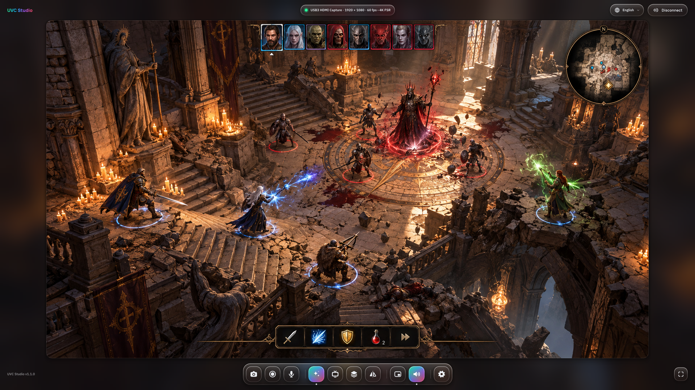

## Piattaforme e download

Un unico codice sorgente: stesse funzioni e stesso numero di versione su tutte le piattaforme.

| Piattaforma | Download | Acquisizione video | Audio | Grafica | Registrazione |
| --- | --- | --- | --- | --- | --- |
| Linux (x86_64) | [`UVCStudio-v1.1.0-x86_64.AppImage`](https://github.com/mosesmoon/uvc-studio/releases/download/v1.1.0/UVCStudio-v1.1.0-x86_64.AppImage) | Video4Linux2 | PulseAudio / PipeWire / ALSA | OpenGL 3.3 | H.264 (hardware VA-API / NVENC / AMF) + AAC, MP4 — ne serve uno |
| Windows (x64) | [`UVCStudio-Setup-v1.1.0.exe`](https://github.com/mosesmoon/uvc-studio/releases/download/v1.1.0/UVCStudio-Setup-v1.1.0.exe) (programma di installazione) o [`UVCStudio-Portable-v1.1.0.zip`](https://github.com/mosesmoon/uvc-studio/releases/download/v1.1.0/UVCStudio-Portable-v1.1.0.zip) (portable) | Media Foundation | WASAPI | OpenGL 3.3 | H.264 (NVENC / AMF / Intel tramite Media Foundation, altrimenti l'encoder integrato in Windows) + AAC, MP4 — ne serve uno |
| Meta Quest 2 / Pro / 3 / 3S | [`UVCStudio-Quest-v1.1.0-Free.apk`](https://github.com/mosesmoon/uvc-studio/releases/download/v1.1.0/UVCStudio-Quest-v1.1.0-Free.apk) (sideload) o Meta Horizon Store (in arrivo) | Host USB, libuvc | Audio USB della scheda, letto direttamente (stereo o 5.1) | OpenGL ES 3 (finestra 2D), OpenXR (immersiva) | H.264 + AAC (MediaCodec hardware), MP4 |

Codice sorgente (Linux e Windows, licenza MIT): questo repository oppure [`UVCStudio-v1.1.0-src.tar.gz`](https://github.com/mosesmoon/uvc-studio/releases/download/v1.1.0/UVCStudio-v1.1.0-src.tar.gz).

Su Meta Quest, l'upscaling 4K e la profondità 3D sono gratuiti per 30 minuti al giorno ciascuno; UVC Studio Platinum, un acquisto in-app una tantum, li rende illimitati. Su Linux e Windows tutte le funzioni sono gratuite.

## Screenshot

Linux a 1920 × 1080; fai clic su un'immagine per vederla a grandezza naturale. La finestra 2D su Meta Quest ha la stessa interfaccia.

<table>
<tr><td width="50%"><a href="docs/screenshots/01-ready.png">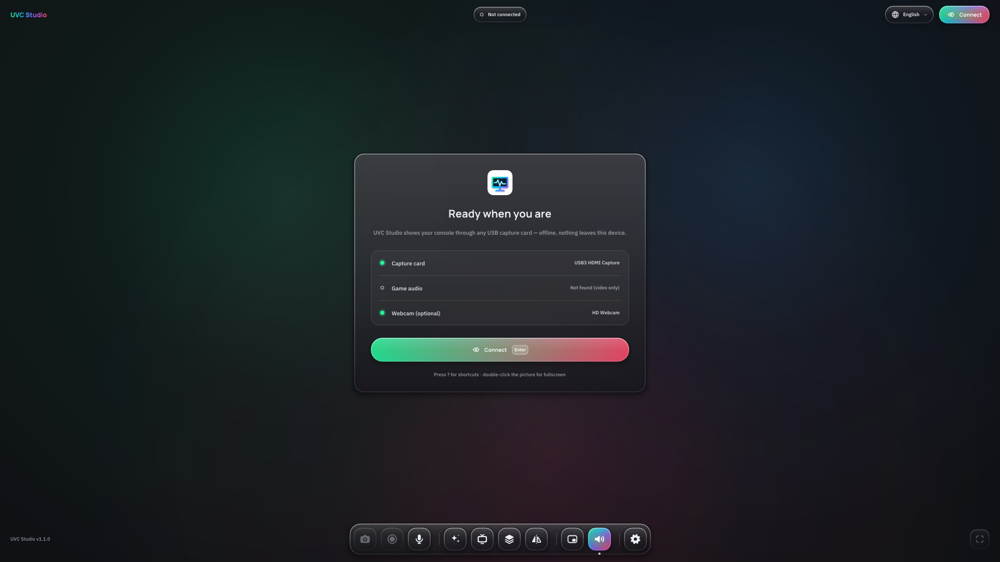</a> Schermata iniziale: scheda di acquisizione, audio del gioco e webcam controllati dal vivo</td><td width="50%"><a href="docs/screenshots/03-4k-upscaling.png">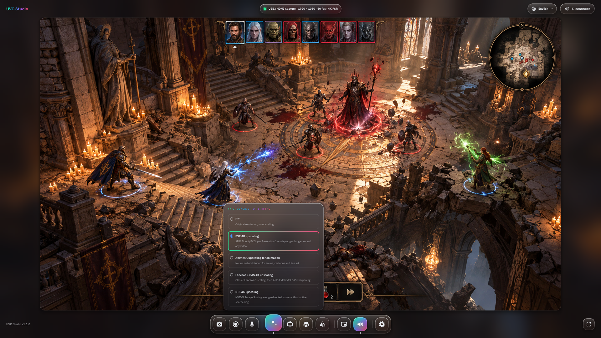</a> Upscaling 4K: quattro metodi tra cui scegliere</td></tr>
<tr><td width="50%"><a href="docs/screenshots/04-settings.png">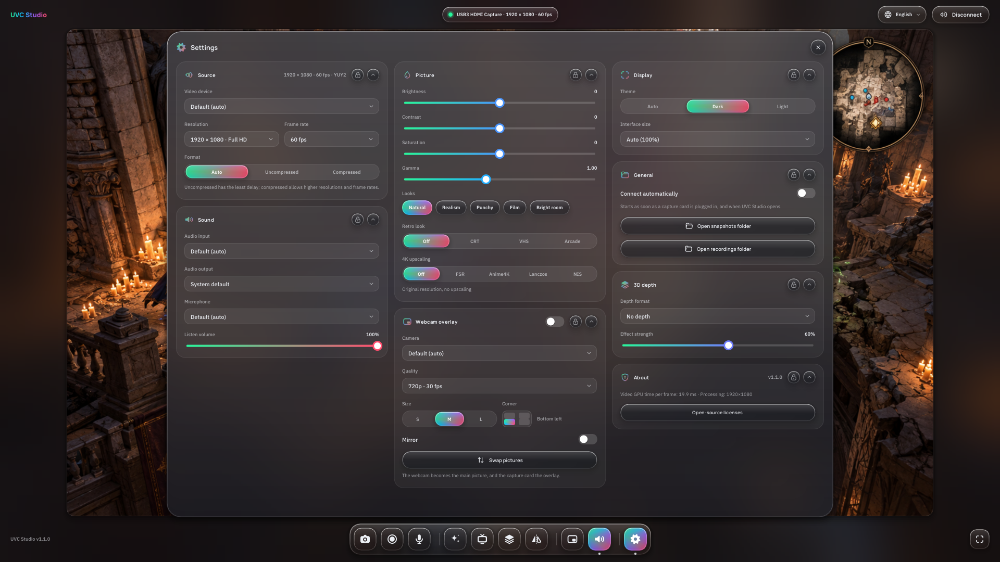</a> Impostazioni: tutto in un unico pannello di vetro</td><td width="50%"><a href="docs/screenshots/05-webcam-overlay.png">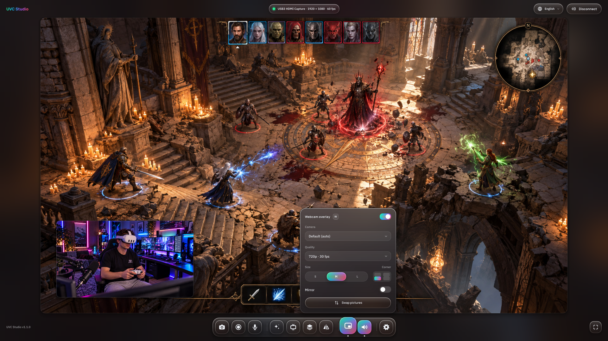</a> Webcam sovrapposta al gioco</td></tr>
<tr><td width="50%"><a href="docs/screenshots/06-retro-vhs.png">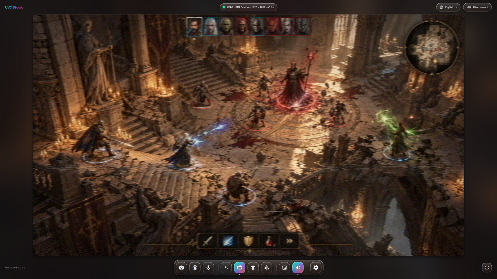</a> Effetto retrò: VHS</td><td width="50%"><a href="docs/screenshots/07-3d-depth.png">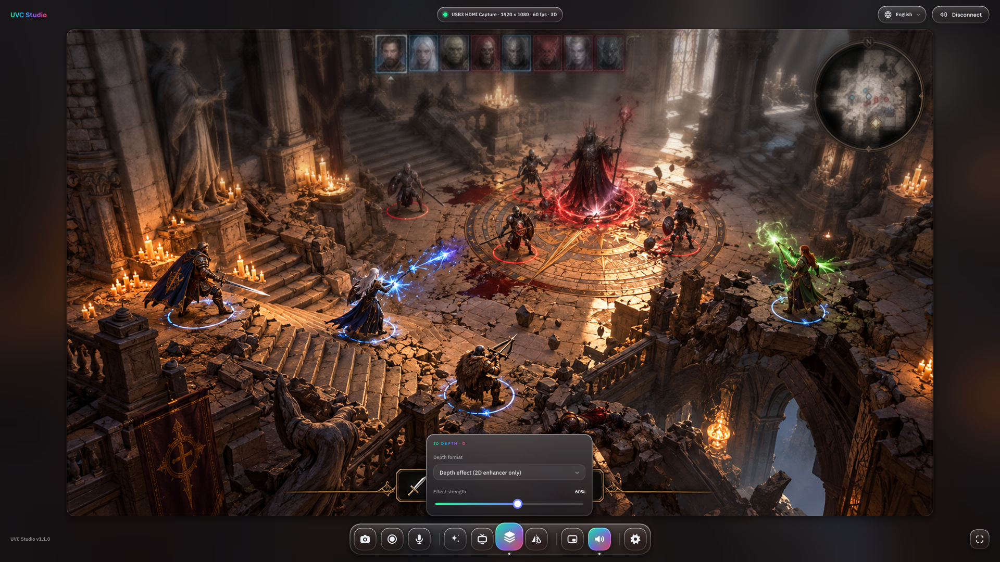</a> Profondità 3D</td></tr>
<tr><td width="50%"><a href="docs/screenshots/08-shortcuts.png">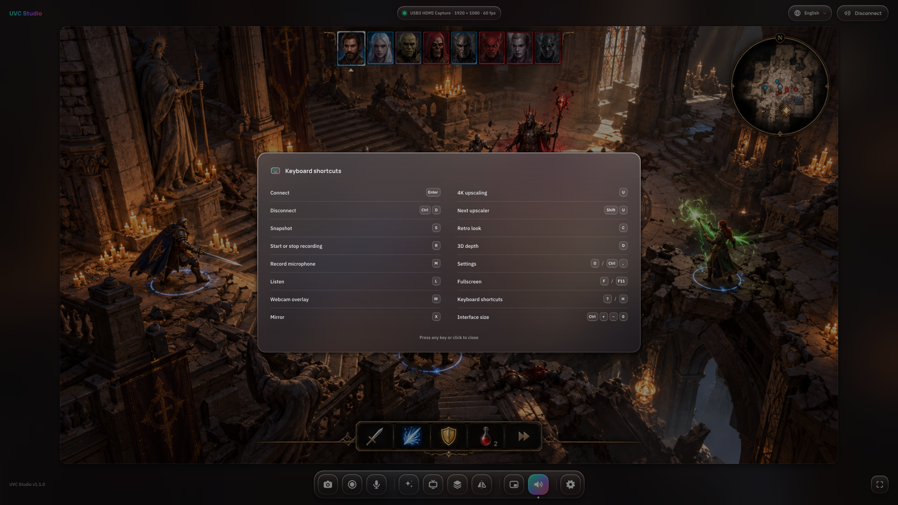</a> Scorciatoie da tastiera</td><td width="50%"><a href="docs/screenshots/09-light-theme.png">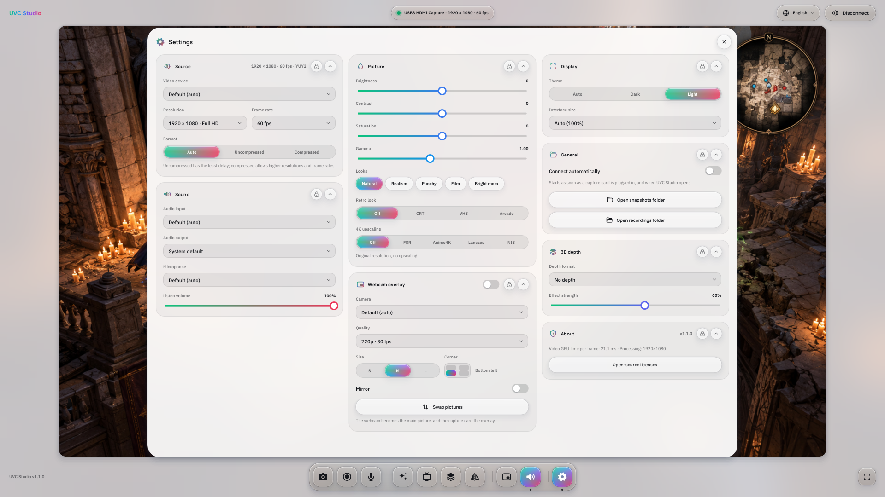</a> Tema chiaro</td></tr>
<tr><td width="50%"><a href="docs/screenshots/10-zh-TW.png">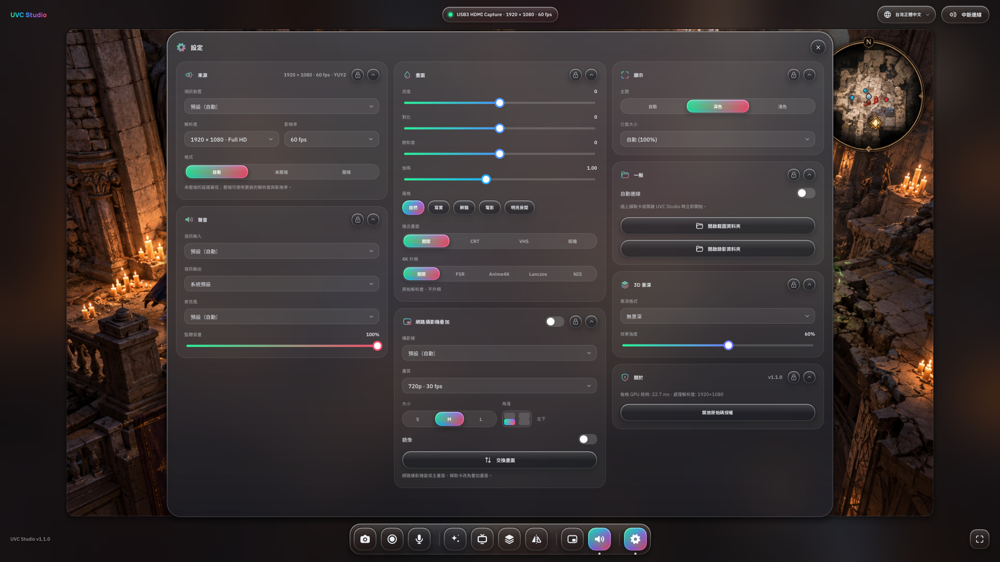</a> Interfaccia in 台灣正體中文</td><td width="50%"><a href="docs/screenshots/11-languages.png">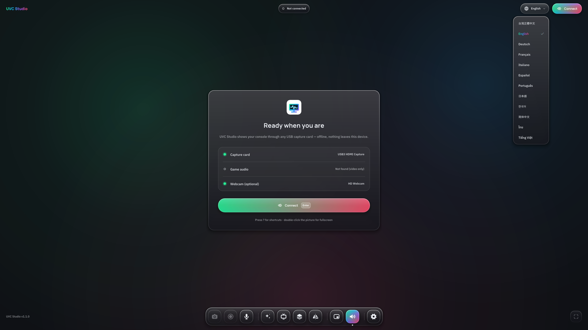</a> 12 lingue dell'interfaccia</td></tr>
</table>

## Per iniziare

1. Collega la scheda di acquisizione via USB e avvia UVC Studio. La **schermata iniziale** controlla in tempo reale tre voci: *Scheda di acquisizione*, *Audio di gioco* e *Webcam (facoltativa)*. Se manca la scheda compare «Non trovata — collegala via USB»; se manca l'audio, «Non trovato (solo video)».
2. Fai clic su **Connetti** (nella schermata iniziale o in alto a destra) oppure premi `Invio`. Con **Connetti automaticamente** attivo (Impostazioni → Generali, attivo per impostazione predefinita), UVC Studio si connette da solo appena colleghi una scheda, e all'avvio se è già collegata.
3. Gioca. **Disconnetti** (lo stesso pulsante, oppure `Ctrl+D`) chiude tutto; un'eventuale registrazione in corso viene prima conclusa e salvata.

Non ci sono più pausa e ripresa: UVC Studio è connesso oppure no. Se scolleghi la scheda, sotto l'indicatore di connessione compare un errore e l'app torna alla schermata iniziale; con la connessione automatica attiva, si ricollega non appena la scheda torna disponibile.

## Acquisizione e audio

Qualsiasi scheda di acquisizione UVC funziona senza driver aggiuntivi: ShadowCast, Elgato, AVerMedia, Magewell e le comuni chiavette HDMI USB 3 si comportano allo stesso modo.

- **Le modalità reali della scheda**: risoluzioni e frequenze dei fotogrammi sono quelle dichiarate dalla scheda, dalla più alta alla più bassa, con l'etichetta 4K, QHD, Full HD, HD o SD. Per impostazione predefinita UVC Studio sceglie la risoluzione più alta che raggiunge almeno 59 fps. Formato: Automatico, Non compresso (latenza minima) o Compresso (risoluzioni e frequenze più alte).
- **Sceglie i dispositivi giusti**: finché non hai salvato nulla, scheda di acquisizione, relativo audio e webcam vengono scelti in base al nome, così una videocamera integrata o virtuale non viene scambiata per la scheda. I dispositivi con lo stesso nome ricevono l'aggiunta (2), (3)…
- **Bassa latenza**: viene sempre mostrato il fotogramma più recente, mai una coda di fotogrammi vecchi.
- **Ricorda la configurazione** e rileva le schede collegate o scollegate mentre l'app è in uso.
- **Ascolto** (`L`): senti l'audio del gioco da altoparlanti o cuffie. Passando il mouse sul riquadro del dock trovi un interruttore, il volume e l'uscita audio attuale; la riga «Uscita» porta direttamente a Impostazioni → Audio.
- **Modalità effettiva in vista**: Impostazioni → Sorgente mostra il flusso reale, per esempio 3840 × 2160 · 60 fps · YUY2.
- **Audio su Meta Quest**: l'app legge l'audio della scheda direttamente via USB (USB Audio Class 1 e 2, comprese le chiavette MacroSilicon MS2109) — Impostazioni → Audio → Ingresso audio → «Audio della scheda di acquisizione (USB)». Impostazioni → Audio → «Canali audio del gioco»: **Stereo 2CH** (predefinito) o **Surround 6CH** — 5.1 dalle schede con modalità a 6 canali (come la CJ-16) e dalle console che emettono 5.1 via HDMI (come Switch 2 impostata su Surround); le registrazioni restano stereo.
- **Ripristino automatico su Quest**: se la scheda smette di inviare immagini, l'app la riapre da sola (fino a due volte), poi ti chiede di controllare la sorgente HDMI o di ricollegare la scheda.

## Immagine

Quattro upscaler 4K, tre effetti retrò e la profondità 3D vengono elaborati dalla GPU fotogramma per fotogramma, senza ritardi oltre al tempo di calcolo della GPU.

**Upscaling 4K** (`U`): fai clic sul riquadro del dock o premi `U` per attivarlo o disattivarlo, passa il mouse sul riquadro per scegliere la modalità, e `Maiusc+U` passa alla successiva. In Impostazioni → Immagine → Upscaling 4K trovi *Disattivato*, *FSR*, *Anime4K*, *Lanczos* e *NIS*: scegliendo una modalità l'upscaling si attiva, mentre *Disattivato* ricorda l'ultima modalità usata per la volta successiva.

| Modalità | Come funziona | Ideale per | Fattore |
| --- | --- | --- | --- |
| Upscaling 4K FSR (predefinito) | AMD FidelityFX Super Resolution 1: ingrandimento adattivo ai contorni (EASU) più nitidezza RCAS | Giochi e qualsiasi video | Da 720p / 1080p a 4K; sorgenti SD fino a 3× |
| Upscaling 4K Anime4K per l'animazione | Rete neurale Anime4K ×2 (taglia M su desktop, S su Quest), poi FSR per il resto | Anime, cartoni animati, disegni al tratto | 2× con la rete, poi fino al 4K |
| Upscaling 4K Lanczos + CAS | Ricampionamento Lanczos-3 (6 campioni per asse) più nitidezza AMD FidelityFX CAS | Ridimensionamento classico e neutro | Fino al 4K |
| Upscaling 4K NIS | NVIDIA Image Scaling 1.0.3: scaler a 6 campioni orientato ai contorni con nitidezza adattiva | Dettagli nitidi | Fino a 2×, oltre interviene Lanczos-3 |

L'upscaler ricalcola solo quando arriva un nuovo fotogramma. Se il Quest non supporta render target a mezza precisione, Anime4K passa a FSR.

- **Effetto retrò** (`C`): passa il mouse sul riquadro del dock per scegliere *Disattivato*, *CRT*, *VHS* o *Arcade*; `C` li scorre in quest'ordine e un clic sul riquadro alterna tra *Disattivato* e l'ultimo effetto usato. La stessa scelta è in Impostazioni → Immagine → Effetto retrò. L'effetto viene applicato all'immagine finale, dopo l'upscaling 4K, quindi i due si combinano, e compare anche in istantanee, registrazioni e sullo schermo gigante del Quest. La scelta viene ricordata.
  - **CRT**: un televisore a tubo catodico — maschera a fessure sfalsate, linee di scansione che si scuriscono in base alla luminosità, schermo leggermente bombato e vignettatura morbida.
  - **VHS**: una videocassetta di casa — immagine un po' più morbida, colori che sbavano verso destra, toni caldi leggermente sbiaditi con neri sollevati, leggero rumore, lieve ondeggiamento delle righe e, ogni tanto, una tenue banda di tracking che scende sullo schermo (il testo resta leggibile).
  - **Arcade**: il monitor di un cabinato arcade — raster a bassa risoluzione con linee di scansione scure e marcate, griglia RGB verticale, leggero bagliore attorno alle zone chiare, colori vivaci e una lieve curvatura.
- **Profondità 3D** (`D`): stima ciò che nell'immagine è vicino e ciò che è lontano. Passa il mouse sul riquadro, o apri Impostazioni → Profondità 3D, per scegliere il **Formato profondità** e l'**Intensità dell'effetto**. *Effetto profondità (solo potenziamento 2D)* rende il primo piano più nitido e vivace e lo sfondo più morbido e sfumato; i formati stereo per display 3D sono descritti più avanti; nella modalità immersiva del Quest, *Schermo gigante 3D stereo* trasforma lo schermo gigante in vero 3D stereoscopico. `D` o un clic sul riquadro alterna tra *Nessuna profondità* e l'ultimo formato usato.
- **Luminosità, contrasto, saturazione** (Impostazioni → Immagine): da −40 a +40, con 0 come valore neutro. **Gamma**: da 0,70 a 1,40 (1,00 è neutro); sopra 1,00 i mezzitoni si schiariscono, sotto si scuriscono, mentre il nero e il bianco restano invariati. **Stili** predefiniti: *Naturale*, *Realistico* (contrasto naturale con una leggera curva a S e colori sobri, senza perdere dettaglio nelle ombre), *Vivace*, *Cinema* e *Stanza luminosa* (ora con un po' più di gamma, così le scene scure restano leggibili in una stanza illuminata).
- **Specchia** (`X`): capovolge orizzontalmente l'intera immagine.

## Formati 3D stereo (Linux / Windows)

Su desktop il menu del formato profondità (sul riquadro Profondità 3D o in Impostazioni → Profondità 3D) offre anche quattro formati stereo, che inviano vero 3D stereoscopico a un display 3D. Imposta il display sullo stesso formato 3D e passa a schermo intero (`F`); istantanee e registrazioni restano in 2D. Testi ed elementi dell'HUD vengono riconosciuti e mantenuti vicino al piano dello schermo, e la profondità è più uniforme: le lettere si spostano in blocco per entrambi gli occhi e non sembrano più tagliate.

| Formato | Per |
| --- | --- |
| Affiancato, intero (3840×1080) | Occhiali XR in modalità 3D, come XREAL, VITURE e RayNeo |
| Affiancato, metà | TV 3D |
| Sopra e sotto | TV 3D e proiettori |
| Occhiali rosso / ciano | Occhiali anaglifi rosso / ciano |

## Sovrapposizione webcam, istantanee e registrazione

Quello che vedi è quello che salvi: effetti, specchiatura e sovrapposizione webcam finiscono in ogni istantanea e in ogni registrazione.

- **Sovrapposizione webcam** (`W`): la tua webcam sopra il gioco, in uno dei quattro angoli (in basso a sinistra per impostazione predefinita) e in dimensione S, M o L (18, 26 o 36 % della larghezza dell'immagine).
  - Trascinala dove vuoi: quando la rilasci scivola nell'angolo più vicino. La rotella del mouse sopra di essa ne cambia la dimensione.
  - Al passaggio del mouse compare una piccola barra con *Specchia*, *Dimensione* e *Rimuovi*.
  - Dal riquadro del dock (o da Impostazioni → Sovrapposizione webcam) scegli *Videocamera*, *Qualità* (720p · 30 fps, 1080p · 30 fps o 1080p · 60 fps), *Dimensione*, *Angolo*, *Specchia* e **Scambia immagini**: la webcam diventa l'immagine principale e la scheda di acquisizione la sovrapposizione.
- **Istantanea** (`S`): l'immagine corrente in PNG.
- **Registra** (`R`): MP4 con video H.264 e audio AAC a 192 kbit/s. Il bitrate segue il flusso (larghezza × altezza × fps × 0,12, tra 8 e 50 Mbit/s: circa 15 Mbit/s a 1080p60, 50 Mbit/s a 4K60). L'indicatore di connessione mostra REC e il tempo trascorso.
  - **Windows:** non è incluso alcun encoder software. Per registrare serve un encoder grafico NVIDIA (NVENC), AMD (AMF) o Intel, oppure l'encoder H.264 integrato in Windows (Media Foundation; le edizioni «N» di Windows richiedono il Media Feature Pack).
  - **Linux:** anche qui non è incluso alcun encoder software. Per registrare serve una grafica Intel o AMD tramite VA-API (con il driver VA-API installato), NVIDIA NVENC (driver proprietario) o AMD AMF.
  - Senza nessuno di questi tutto il resto funziona, ma «Registra» segnala «Nessun encoder video: per registrare serve una grafica NVIDIA, AMD o Intel».
- **Registra microfono** (`M`): mescola la tua voce all'audio di gioco.
- **Nomi e cartelle dei file**: `UVC Studio 2026-10-06 21.30.15.png` o `.mp4` (data e ora; se il nome esiste già viene aggiunto un numero). Le istantanee finiscono in **Immagini/UVC Studio**, le registrazioni in **Video/UVC Studio**, con l'avviso «Salvato in Pictures/UVC Studio» e il pulsante **Mostra**; in Impostazioni → Generali trovi anche «Apri cartella istantanee» e «Apri cartella registrazioni». Su Quest i file vanno nella Galleria (`Pictures/UVC Studio` e `Movies/UVC Studio`), visibili nell'app File e via USB.

## Meta Quest

Collega la scheda di acquisizione alla porta USB-C del visore e gioca in una finestra ridimensionabile o su uno schermo virtuale gigante, con vero 3D stereoscopico.

- **Installazione**: dal Meta Horizon Store (in arrivo), oppure installa `UVCStudio-Quest-v1.1.0-Free.apk` dalle Releases di questo progetto con il visore in modalità sviluppatore (Meta Quest Developer Hub, SideQuest o `adb install`). Platinum si può acquistare solo nella versione installata dallo store.
- **Collegamento**: funziona anche con un adattatore USB-C OTG o un hub. Consenti l'apertura di UVC Studio quando colleghi la scheda (meglio con «Sempre») e i permessi per fotocamera e microfono, che Android richiede per accedere alle schede di acquisizione USB. Le fotocamere del visore non vengono mai usate.
- **Decodifica**: le schede H.264 e HEVC vengono decodificate dal decoder hardware integrato nel visore; l'FFmpeg incluso si occupa solo del MJPEG.
- **Finestra 2D** (predefinita): l'interfaccia completa della versione desktop in un pannello di Horizon OS che puoi spostare e ridimensionare. Un doppio pinch sull'immagine attiva o disattiva lo schermo intero.
- **Modalità immersiva**: il riquadro del visore in fondo al dock, dopo Impostazioni, passa allo schermo virtuale gigante e ritorno. UVC Studio si disconnette, cambia modalità e si ricollega da solo dall'altra parte.
- **Profondità 3D sul Quest**: nella finestra 2D puoi scegliere *Nessuna profondità* o *Effetto profondità*; nella modalità immersiva *Nessuna profondità* o *Schermo gigante 3D stereo*.

| In modalità immersiva | Come |
| --- | --- |
| Fare clic sul pannello di controllo | Punta con il controller e premi il grilletto, oppure fai pinch con la mano |
| Spostare il pannello di controllo | Afferra la barra bianca sotto il pannello e trascina; spingi o tira per cambiare la distanza. Impostazioni → VR → «Ripristina la posizione del pannello» lo rimette a posto |
| Spostare lo schermo | Afferra la barra bianca sotto lo schermo e trascina; spingi o tira la mano per cambiare la distanza |
| Ridimensionare lo schermo | Punta un angolo finché compare una staffa, poi fai pinch e trascina |
| Più vicino / più lontano, più piccolo / più grande | Levetta su / giù, sinistra / destra |
| Nascondere o mostrare il pannello | Doppio pinch sullo schermo, oppure B, Y o Menu |
| Ricentrare | Tieni premuto il pulsante Meta |
| Preimpostazioni dello schermo | Impostazioni → VR: sfondo (passthrough o stanza buia), forma dello schermo (piatto o curvo), dimensione e distanza dello schermo, frequenza di aggiornamento 72 / 90 / 120 Hz (predefinita 90) |

- **Menu di sistema**: mentre è aperto l'app continua a disegnare, nasconde i puntatori e silenzia l'audio.
- **Meno calore**: l'upscaling si ferma a ciò che lo schermo gigante può davvero mostrare (circa 30 pixel per grado, al massimo 2560 di larghezza) e la coppia stereo viene resa alla stessa dimensione.
- **Protezione dal surriscaldamento**: tiene d'occhio lo stato termico di Android e le notifiche termiche di OpenXR. Quando il visore si scalda passa a FSR e 72 Hz; quando diventa troppo caldo mette in pausa upscaling e profondità 3D. Le tue impostazioni non cambiano e un avviso ti dice quando si è raffreddato.
- **Indicatore di carico**: durante la connessione, Impostazioni → Informazioni mostra il tempo GPU per fotogramma, la risoluzione di elaborazione e la temperatura del visore.

## Interfaccia

Tutta l'interfaccia segue lo stile Liquid Glass: superfici traslucide e satinate che, durante la connessione, lasciano intravedere una copia sfocata e più satura del gioco.

- **Barra superiore**: a sinistra il logo UVC Studio; al centro l'**indicatore di connessione** («Non connesso»; un punto verde con dispositivo · risoluzione · fps, più ▸ 4K e l'upscaler e · 3D; oppure un REC rosso pulsante con il tempo di registrazione); a destra il menu della lingua e **Connetti / Disconnetti**. Gli errori compaiono in rosso sotto l'indicatore per qualche secondo.
- **Dock**: quattro gruppi — *Istantanea, Registra, Registra microfono* · *Upscaling 4K, Effetto retrò, Profondità 3D, Specchia* · *Sovrapposizione webcam, Ascolto* · *Impostazioni*. I riquadri si ingrandiscono sotto il puntatore, le funzioni attive si illuminano con il gradiente del marchio e ogni suggerimento mostra il tasto di scelta rapida. La versione è in basso a sinistra, il pulsante Schermo intero in basso a destra.
- **Impostazioni**: un grande pannello di vetro con schede su un massimo di tre colonne bilanciate, così tutto si regola senza scorrere: Sorgente, Audio, Immagine, Sovrapposizione webcam, Visualizzazione, VR (modalità immersiva del Quest), Generali, Profondità 3D e Informazioni — nella disposizione automatica la scheda «Profondità 3D» sta subito sopra «Informazioni». La scheda «Informazioni» mostra la versione, il tempo GPU per fotogramma e la risoluzione di elaborazione durante la connessione (più la temperatura del visore su Quest) e il pulsante «Licenze open source»; la nota sulla privacy si trova nella finestra che il pulsante apre.
  - **Comprimere una scheda**: il pulsante rotondo con la freccia all'estrema destra dell'intestazione, a destra del lucchetto, riduce la scheda alla sola intestazione (titolo, lucchetto e pulsante restano) e la riapre. Le altre schede scorrono in su, nessuna cambia colonna e le schede compresse vengono ricordate.
  - **Disponi le schede come vuoi**: ogni scheda ha un lucchetto in alto a destra nell'intestazione e all'inizio tutte le schede sono bloccate. Fai clic sul lucchetto («Sblocca per spostare»), poi trascina la scheda per l'intestazione in un altro punto delle tre colonne; uno spazio vuoto indica dove andrà a finire ed `Esc` annulla il trascinamento. Un altro clic sul lucchetto («Blocca la posizione») fissa la scheda. Le schede bloccate restano al loro posto, quelle sbloccate si spostano tra di esse. La disposizione e le schede sbloccate vengono ricordate al successivo avvio. «Ripristina disposizione», accanto al pulsante di chiusura e visibile solo mentre usi una disposizione tua, riporta la disposizione automatica e blocca tutte le schede. Se la finestra è troppo stretta per tre colonne viene mostrata la disposizione automatica, mentre la tua resta salvata per quando la finestra torna abbastanza larga. Nella finestra 2D del Quest funziona allo stesso modo con il puntatore del controller.
- **Lingue**: 台灣正體中文, English, Deutsch, Français, Italiano, Español, Português, 日本語, 한국어, 简体中文, ไทย e Tiếng Việt, dal menu di vetro in alto a destra. Al primo avvio l'app segue la lingua del sistema.
- **Temi**: Automatico (chiaro dalle 06:00 alle 18:00), Scuro o Chiaro.
- **Dimensione interfaccia**: segue lo schermo (1080p 100%, 1440p circa 135%, 4K 200%); puoi cambiarla in Impostazioni → Visualizzazione o con `Ctrl` `+` / `−` / `0`.
- **Caratteri e icone**: Manrope e IBM Plex Sans (IBM Plex Sans Thai per il thailandese, Noto Sans CJK TC per cinese, giapponese e coreano); le icone sono disegnate appositamente per UVC Studio.
- **Schermo intero**: `F`, `F11`, il pulsante in basso a destra o doppio clic sull'immagine; `Esc` per uscire.

## Scorciatoie da tastiera (Linux / Windows)

Premi `?` o `H` nell'app per vedere lo stesso elenco; qualsiasi tasto o un clic lo chiude.

| Tasto | Azione |
| --- | --- |
| `Invio` | Connetti |
| `Ctrl+D` | Disconnetti |
| `S` | Istantanea |
| `R` | Avvia o interrompi la registrazione |
| `M` | Attiva / disattiva la registrazione del microfono |
| `L` | Attiva / disattiva l'ascolto |
| `W` | Attiva / disattiva la sovrapposizione webcam |
| `X` | Specchia |
| `U` | Attiva / disattiva l'upscaling 4K |
| `Maiusc+U` | Upscaler successivo (attiva l'upscaling) |
| `C` | Effetto retrò: Disattivato → CRT → VHS → Arcade |
| `D` | Profondità 3D: alterna tra *Nessuna profondità* e l'ultimo formato |
| `O` o `Ctrl+,` | Impostazioni |
| `F` o `F11` | Schermo intero |
| `Esc` | Annulla il trascinamento di una scheda, esci dallo schermo intero o chiudi le impostazioni |
| `?` o `H` | Scorciatoie da tastiera |
| `Ctrl` `+` / `−` / `0` | Interfaccia più grande / più piccola / ripristina |

## Privacy

UVC Studio funziona interamente sul tuo dispositivo. Immagine, audio e registrazioni non lo lasciano mai — nessun account, nessun caricamento, nessun tracciamento, e l'app non si collega mai alla rete. Su Meta Quest, l'acquisto di Platinum e la sua verifica passano dal servizio Meta Horizon Store del visore; UVC Studio non invia nulla. L'informativa sulla privacy completa è in [PRIVACY.md](PRIVACY.md).

## Licenze

UVC Studio per Linux e Windows è open source con [licenza MIT](LICENSE); la versione per Meta Quest non è open source. UVC Studio non contiene componenti GPL; FFmpeg è compilato solo con licenza LGPL (su Quest con il solo decoder MJPEG e come librerie condivise sostituibili). Altri componenti: SDL2, Dear ImGui, miniaudio, stb, NanoSVG, libusb e libuvc (Quest), il loader OpenXR, AMD FidelityFX FSR 1 e CAS, Anime4K e NVIDIA Image Scaling. I caratteri (Manrope, IBM Plex Sans, IBM Plex Sans Thai, Noto Sans CJK TC) sono distribuiti con licenza SIL Open Font License. Tutti i componenti e il testo completo delle licenze sono elencati nell'app in Impostazioni → Informazioni → Licenze open source. La versione per Meta Quest include anche il loader del Meta Platform SDK (Oculus SDK License) per l'acquisto nello store.
